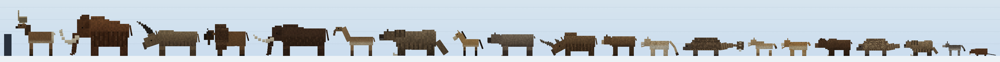

# Ice Age Animals

A Minecraft **Bedrock Edition** add-on and **Java Edition** (Fabric) mod with **20 animals of the last Ice Age**, each one built to the size of the real animal: woolly mammoths, sabre-toothed cats, giant ground sloths, cave bears, woolly rhinos and more. Ride a mammoth across the frozen steppe, dig frozen remains out of the permafrost, and hunt them with [Realistic Hunting](https://github.com/ulfendk/minecraft-hunting).

**Download:** [Bedrock (.mcaddon)](https://github.com/ulfendk/minecraft-iceage-animals/releases/latest/download/IceAgeAnimals.mcaddon) · [Java/Fabric (.jar)](https://github.com/ulfendk/minecraft-iceage-animals/releases/latest/download/IceAgeAnimals-fabric.jar) · [All releases](https://github.com/ulfendk/minecraft-iceage-animals/releases) · **[Animal catalogue (GitHub Pages)](https://ulfendk.github.io/minecraft-iceage-animals/)** · **[Dansk side](https://ulfendk.github.io/minecraft-iceage-animals/da/)**



## Contents

| | |
|---|---|
| **Proboscideans** | Woolly mammoth, American mastodon |
| **Rhinos** | Woolly rhinoceros, Elasmotherium |
| **Hoofed animals** | Steppe bison, Irish elk (Megaloceros), wild horse, Macrauchenia |
| **Sloths and armadillos** | Giant ground sloth (Megatherium), Megalonyx, Glyptodon, Doedicurus |
| **Carnivores** | Smilodon, Homotherium, cave lion, cave bear, short-faced bear, dire wolf |
| **Others** | Diprotodon, giant beaver (Castoroides) |
| **Plants** | Steppe grass, cotton grass, arctic poppy, dwarf willow |
| **Blocks** | Permafrost (drops frozen remains), mammoth wool block |
| **Items** | Fur hood, coat, leggings and boots, mammoth wool, ivory, frozen remains, game meat, Ice Age Field Guide |

### True to size
Each animal is built to the real one's shoulder height and nose-to-rump length (1 block = 1 m), and the build fails if a model is more than 10% off (see [Real sizes](#real-sizes)). A woolly mammoth stands 3.2 m at the shoulder, as tall as an African elephant. An Irish elk is 2 m tall with antlers 3.5 m across, and a giant beaver is as long as a person.

| Animal | Shoulder | Length (nose to rump) | Weight |
|---|---|---|---|
| Woolly mammoth | 3.2 m | 4.4 m | 4 t–7 t |
| American mastodon | 2.7 m | 4.6 m | 3.5 t–7 t |
| Woolly rhinoceros | 1.75 m | 3.6 m | 1.8 t–2.9 t |
| Elasmotherium | 2.1 m | 4.5 m | 3.5 t–4.5 t |
| Steppe bison | 2 m | 3.4 m | 700 kg–1.2 t |
| Irish elk | 2 m | 3.1 m | 450 kg–700 kg |
| Wild horse | 1.4 m | 2.2 m | 300 kg–450 kg |
| Macrauchenia | 1.6 m | 3 m | 900 kg–1.1 t |
| Diprotodon | 1.8 m | 3.8 m | 2 t–2.8 t |
| Glyptodon | 1.4 m | 2.6 m | 800 kg–2 t |
| Doedicurus | 1.5 m | 3 m | 1.4 t–2.4 t |
| Giant ground sloth | 2 m | 4.6 m | 3 t–4.5 t |
| Megalonyx | 1.2 m | 2.5 m | 800 kg–1.2 t |
| Giant beaver | 0.6 m | 1.5 m | 60 kg–110 kg |
| Smilodon | 1.15 m | 2 m | 220 kg–400 kg |
| Homotherium | 1.1 m | 1.9 m | 150 kg–230 kg |
| Cave lion | 1.2 m | 2.3 m | 200 kg–340 kg |
| Cave bear | 1.35 m | 2.9 m | 350 kg–600 kg |
| Short-faced bear | 1.6 m | 2.8 m | 600 kg–950 kg |
| Dire wolf | 0.85 m | 1.6 m | 55 kg–70 kg |

### Features
- **Ride the giants:** tame a woolly mammoth with hay and ride it with a friend and a chest. You can also saddle a woolly rhino, an Elasmotherium, an Irish elk or a wild horse.
- **The Mammoth Steppe:** on Bedrock, with the *Custom Biomes* experiment, a cold, dry grassland with patchy snow appears among snowy plains, taiga and plains. Without the experiment, and on Java, the steppe animals live in the cold vanilla biomes. The steppe plants grow in every cold biome.
- **Frozen remains:** permafrost lies a few blocks under the surface of cold biomes. Mine it for frozen remains, use them on a lit campfire, and a young Ice Age animal climbs out of the meltwater about 20 seconds later.
- **Fur armour:** mammoths and woolly rhinos drop mammoth wool for a fur hood, coat, leggings and boots. On Java, fur armour keeps you from freezing in powder snow, like leather. Mammoths and mastodons sometimes drop ivory.
- **Behaviour:** predators hunt horses, deer and bison, and prey flees from them. Mammoths trumpet, bears rear up, ground sloths stand up to browse, a glyptodon pulls in its head when hurt, and a Doedicurus swings its spiked tail club at whatever hits it.
- **An unlikely herd** (a nod to the *Ice Age* films): now and then a naturally spawned woolly mammoth is joined by a ground sloth and a sabre-toothed cat, and the three travel south together. The cat leaves the others and players alone unless it is hurt. They are ordinary animals of their species. To see it straight away on Bedrock, run `/scriptevent iceage:odd_herd` next to a mammoth.
- **Field Guide:** every player gets one, and it fills in as you spot animals.

### Realistic Hunting
Install [Realistic Hunting](https://github.com/ulfendk/minecraft-hunting) (0.3.0 or later) as well, and every animal is game, on Bedrock and Java:
- Each animal has organs placed in its own model, a weight taken from the real animal (`src/sizes.mjs`), a minimum calibre and a trophy. Mammoths and mastodons give tusks, the Irish elk gives antlers, and the rest give skulls.
- A broadside heart shot is perfect on every animal, and the build checks this (`node tools/check-hunting.mjs -v`). The proboscideans, Elasmotherium, Diprotodon and the giant ground sloth need a .338.
- Spooked and wounded animals flee from hunters. A downed animal lies on its side as a carcass until it's field dressed or rots away.

`tools/vendor/hunting-kit/` is copied from Realistic Hunting by `node tools/sync-hunting-kit.mjs`.

## Install
1. Download `IceAgeAnimals.mcaddon` from the [latest release](https://github.com/ulfendk/minecraft-iceage-animals/releases/latest) and open it. Minecraft imports both packs.
2. Edit or create a world and turn on **Ice Age Animals** under *Behavior Packs*. The resource pack is added automatically.
3. Optional: for the Mammoth Steppe biome, turn on the **Custom Biomes** experiment in a new world.

### Java Edition
1. Install [Fabric Loader](https://fabricmc.net/use/installer/) for Minecraft 26.3.
2. Download `iceage-animals-fabric-<version>.jar` from the [latest release](https://github.com/ulfendk/minecraft-iceage-animals/releases/latest), plus [Fabric API](https://modrinth.com/mod/fabric-api) and [GeckoLib](https://modrinth.com/mod/geckolib).
3. Put all three in your `mods` folder.

## Development
Everything is generated from code. Models, textures and animations come from the specs in `src/animals/`.

```sh
npm ci
npm run build      # writes build/behavior_pack and build/resource_pack
npm run validate   # static checks, mostly for the resource pack
npm run preview    # renders every animal to build/preview/*.png
npm run package    # dist/*.mcaddon and *.mcpack
npm run site       # the website, in build/site/
npm run test:server  # loads the packs in a Bedrock Dedicated Server (needs Docker)

cd java                       # Java edition (needs JDK 25; run `npm run build` first)
./gradlew build               # the Fabric mod jar in java/build/libs
./gradlew runGameTest         # server-side game tests
./gradlew runClientGameTest   # starts a client and screenshots every animal
./gradlew runClient           # play it
```

The Java edition reuses everything generated from the specs (GeckoLib reads the Bedrock model and animation formats). `tools/java.mjs` writes its resources to `java/src/generated/resources`; the behaviour lives in `java/src/main/java` and is driven by the generated `species.json`.

| Path | What it is |
| --- | --- |
| `src/animals/*.mjs` | One file per animal: stats, behaviour, model, texture recipe and animations |
| `src/lib/` | Generators: model + UV packing, procedural textures, animations, entity JSON |
| `src/packs/` | Hand-written pack files, including the Script API code in `behavior_pack/scripts/` |
| `src/items.mjs`, `src/blocks.mjs` | Custom items, blocks, recipes and world generation |
| `src/sizes.mjs`, `src/lib/measure.mjs` | Real sizes and the size check |
| `src/oddherd.mjs` | The odd herd's entity hooks (scripts: `oddherd.js`; Java: `OddHerd.java`) |
| `src/hunting.mjs` | Realistic Hunting profiles: game data and the hit model with organs, per animal |
| `tools/` | Build, validation, preview renderer, packaging, website, server test, Java resources; `tools/vendor/hunting-kit/` is copied from Realistic Hunting by `node tools/sync-hunting-kit.mjs` |
| `java/` | The Fabric mod (Java edition) |

### Real sizes
`src/sizes.mjs` holds every animal's real shoulder height, nose-to-rump length and weight. `npm run validate` measures each model (`src/lib/measure.mjs`, bone rotations applied; hair, horns, tusks, antlers, trunks and tails left out) and fails if the shoulder height or length is more than 10% off. `node tools/validate.mjs --sizes` prints the measurements, and `npm run lineup` renders every animal side by side at the same scale next to a 1.8 m player (`build/lineup.png`; `npm run lineup -- --docs` writes `docs/lineup.png`).

### Adding an animal
Add its real size to `src/sizes.mjs`, copy a similar spec in `src/animals/` (the body builders in `src/lib/bodies.mjs` help: `proboscidean`, `pillarBody`, `caprid`, `felid`, `ursid`, `sloth`, `glyptodont`) and pick `scale` so that model pixels × scale / 16 gives metres. Run `npm run preview <id>` and look at `build/preview/<id>.png`, add a line to `src/guide.mjs` and its Danish name and text to `src/i18n.mjs`, then run `npm run validate` (the size and Realistic Hunting checks are part of it).

### Releases
Bump `version` in `package.json`, add a section to `CHANGELOG.md`, then push a tag such as `v0.2.0`. The release workflow builds and tests the packs, publishes a GitHub Release with the files, and updates the website.

## License
MIT. Not an official Minecraft product. Not approved by or associated with Mojang or Microsoft.
